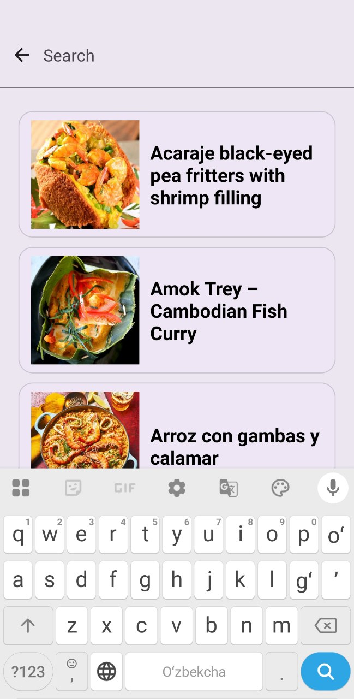
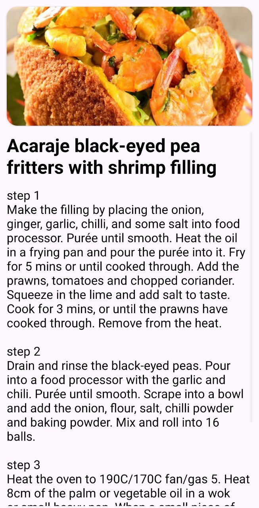
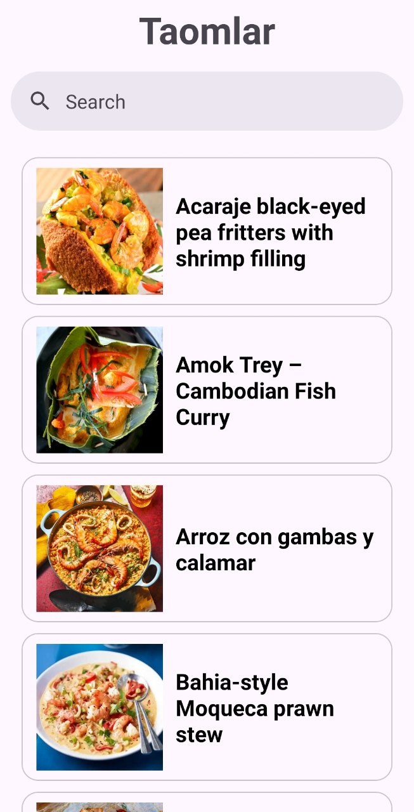

# Taomlar

A simple recipe browser app for Android.

> 📚 **Note:** This is a simple project I built while learning Android app architecture (Clean Architecture, Hilt, Retrofit).

## Screenshots

  
  
  

## Features
- Browse meals by category
- Search meals by name
- View meal photo and cooking instructions

## Tech
- Language: Kotlin
- Architecture: Clean Architecture (data / domain / presentation)
- Networking: Retrofit + Gson
- Dependency injection: Hilt
- Image loading: Glide
- Platform: Android (min SDK 24)

## API
This app uses the free [TheMealDB](https://www.themealdb.com/api.php) API.

## Author
Asadbek
